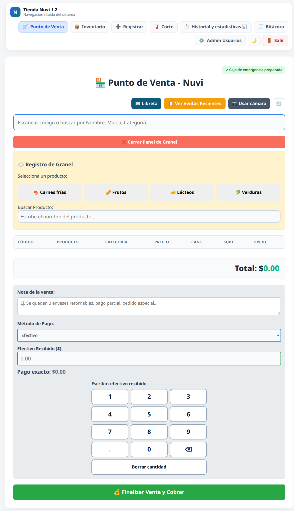

# 🛒 Tienda Nuvi POS

**Un punto de venta pensado para tiendas de barrio y para quienes están detrás
del mostrador.** Nuvi combina una caja sencilla, inventario y herramientas
administrativas en una aplicación web que funciona en computadora o tablet.



*Captura de una instalación de prueba con datos ficticios.*

### Lo esencial, a la mano

- **Cobro ágil:** lector de códigos, búsqueda, venta a granel por importe o
  peso, teclado táctil y pagos en efectivo, tarjeta, transferencia o mixtos.
- **Para la tienda real:** inventario, precios, existencias negativas visibles,
  libreta de fiados, cortes de caja y reportes.
- **Cuando falla la conexión:** caja de emergencia preparada previamente en la
  tablet, ventas pendientes y sincronización al regresar el servidor.
- **Para administración:** bitácora, diagnóstico de errores, compras y mermas.

Desarrollado con PHP, JavaScript y MySQL/MariaDB. El proyecto es de código
abierto y busca evolucionar sin perder de vista la facilidad de uso.

## Estado de esta copia

La instalación crea una base vacía y un primer administrador con contraseña
elegida por quien instala. No usa ni incluye datos de una tienda real.

## Requisitos conocidos

- PHP 8 o posterior con las extensiones `mysqli`, `mbstring` y `json`.
- MySQL o MariaDB.
- Apache o Nginx configurado para servir PHP.

## Instalación en Linux

En Fedora, Debian o Ubuntu, clona o descarga el repositorio y ejecuta:

```bash
sudo bash install.sh
```

El instalador prepara Apache, PHP y MariaDB, crea una base de datos y un usuario
SQL exclusivos, pide los datos del administrador y aplica las migraciones. No
sobrescribe una carpeta de aplicación con contenido ni una base ya existente.
La contraseña del administrador debe tener al menos 12 caracteres.
La copia de instalación omite configuraciones locales conocidas, respaldos y
registros; revisa también que tu paquete no contenga otros archivos privados.

## Instalación en Windows

Actualmente se requiere XAMPP instalado en `C:\xampp`, con Apache y MySQL/MariaDB
iniciados; el instalador **no instala XAMPP automáticamente**. El instalador Windows se compila desde
`installer/windows/setup_POS_nuvi.iss` con Inno Setup 6; el script
`installer/windows/install_windows.ps1` configura la base y solicita el
administrador. GitHub Actions puede compilarlo al publicar una etiqueta `v*`.

Al publicar una etiqueta `v*`, GitHub Actions compila el instalador y lo adjunta
a la Release de esa versión. También puedes compilarlo localmente con
`installer/windows/build.ps1`; el código fuente está en `installer/windows/`.

No subas `config/local.php`, respaldos, registros, credenciales ni datos de
clientes o ventas. Los archivos de configuración local están excluidos por
`.gitignore`. Para la instalación manual, copia `config/local.example.php` como
`config/local.php` y completa los datos de una base de desarrollo vacía.

## Módulos principales

- `punto_de_venta.php`: cobro, lector, granel y cola de ventas sin conexión.

La caja de emergencia requiere abrir previamente el punto de venta con conexión
en HTTPS, en la misma tablet y dirección de la tienda, y confirmar el indicador
«Caja de emergencia preparada». Al fallar el servidor permite registrar ventas
en efectivo, tarjeta o transferencia, y productos a granel por importe o peso.
Los accesos agrupan automáticamente los productos por categoría y tipo, tanto
en la caja normal como en la de emergencia; el buscador sigue disponible. La tarjeta
requiere una configuración de terminal guardada previamente; confirma cada
pago en la terminal o la cuenta antes de registrarlo. Las
ventas quedan en el navegador de esa tablet: no borres sus datos ni desinstales
la PWA hasta sincronizarlas con la misma cuenta. Una venta rechazada por cambios
en el catálogo o precios sigue pendiente y requiere revisión; no debe cobrarse
de nuevo. La fecha principal del reporte será la de sincronización, y la hora
original se guarda en la nota. Consulta los límites y preparación en
[Operación y abastecimiento](documentacion/OPERACION_ABASTECIMIENTO.md).

Antes de depender de la caja de emergencia, prueba la preparación, el apagón
simulado y la sincronización en cada dispositivo. La revisión de pendientes por
administrador o supervisor requiere conexión y conserva la venta hasta que el
servidor confirme su registro.
- `consultar_productos.php` y `obtener_productos_criticos.php`: inventario.
- `corte_caja.php` y `consultar_cortes.php`: cortes y consulta histórica.
  El día operativo va de las 06:00 a las 06:00 del día siguiente y usa el
  reloj de la base de datos, igual que la fecha principal de las ventas.
- `reportes.php` y `exportar_reporte.php`: reportes operativos.
  El reporte de ventas de emergencia selecciona por fecha de recepción y
  muestra la hora UTC declarada por la tablet para revisión manual; no ajusta
  cortes históricos y no incluye ventas aún pendientes en el dispositivo.
- `ventas_utils.php` y `pagos_venta_utils.php`: validación de ventas y pagos.
- `documentacion/`: guías generales de operación y hardware.

En ventas normales se permite vender con existencias insuficientes: el stock
puede quedar negativo y el inventario muestra los productos que deben revisarse.
Las ventas fiadas siguen requiriendo stock suficiente. En el cobro mixto se
introduce la parte en efectivo; el resto se calcula automáticamente y se puede
indicar el efectivo entregado para calcular el cambio. Si se deja vacío, se
considera que el cliente entregó exactamente la parte en efectivo. Cuando el
segundo método es tarjeta, la comisión configurada se muestra por separado.

En **Entradas y mermas** puedes filtrar los productos por la marca o proveedor
habitual registrado en el inventario y escanear un código para seleccionar el
producto. El proveedor de la compra se elige por separado; el filtro de marca no
crea una relación automática entre proveedores y productos.

El stock debe usar un tipo numérico con signo. Si una instalación antigua usa
una columna `UNSIGNED`, se debe respaldar y ajustar su esquema antes de poder
registrar una venta que deje existencias negativas.

Para comprobar la política de stock en una base **de pruebas** migrada, cuyo
nombre termine en `_test`, configura `NUVI_DB_*` y ejecuta
`php tests/ventas_stock_test.php`. La prueba revierte sus datos.

Antes de usarlo con datos reales, configura HTTPS y respaldos, y prueba los
flujos en una instancia aislada. No expongas el POS directamente a Internet.

## Licencia

Este proyecto se distribuye bajo la licencia MIT. Consulta [LICENSE](LICENSE).
